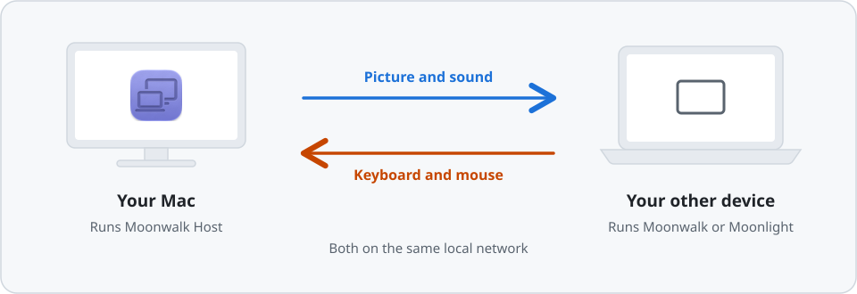

# Moonwalk Host

**The Mac app that lets you connect from Linux.**

Moonwalk Host is the app that runs on your Mac. It sits in the menu bar and
shares your desktop and sound with [Moonwalk](https://github.com/joaodriessen/moonwalk)
on Linux. Connect from the Linux machine and use your Mac apps with the
keyboard and mouse you already have in front of you.

## Install on the Mac

Moonwalk Host is in **alpha**. You need an **Apple Silicon** Mac running
**macOS 14 or later**, and a device on the same local network. Testers install
the signed and notarized DMG supplied by the project.

1. Move Moonwalk Host to **Applications** and open it. Follow the setup window
   to allow **Screen Recording** and **Accessibility**.
2. On Linux, open **Moonwalk**, select the Mac, and click **Pair** to get a PIN.
3. On the Mac, choose **Pair New Device…** from the menu bar icon, select the
   pending device, and enter the PIN. Start the stream from Linux.

[Installation and permissions](docs/INSTALL.md) · [Build from source](docs/BUILDING.md)

<picture>
  <source media="(prefers-color-scheme: dark)" srcset="docs/assets/how-it-works-dark.svg">
  
</picture>

## What happens to the Mac's display?

By default Moonwalk Host asks macOS to make a virtual display for the
client's requested size and refresh rate, then tries to make it the main
display. This is what lets you use a Mac mini without keeping a monitor
attached. Leave the Mac awake and logged in. If you want to share a connected
monitor, turn off **Virtual display** and pick the screen in Settings.

When the last viewer leaves, capture stops and Moonwalk Host releases the
virtual display. If the client left the Desktop session open, the menu
shows **Ready to Resume**. The Mac stays logged in either way.
[Display settings](docs/guides/settings.md#display)

## Already have a Moonlight client?

Pair it the same way, then open **Desktop**. Video, stereo sound, and keyboard
and mouse work over the standard Moonlight protocol. With compatible
versions of both Moonwalk apps you can also share text and images through
the clipboard, transfer files, and request 1× or 2× desktop scaling on
supported Mac display modes. [Client and display support](docs/compatibility.md)

## Who can connect?

Pair only devices you trust. See who's paired in **Settings → Devices**.
To disconnect a viewer from the Mac, use **End Current Session…** under
**Settings → Status**. **Quit Moonwalk Host** stops the streaming service. Use a
trusted local network with port forwarding off. The default LAN setting
leaves video unencrypted, and you can require encryption in Settings.
[Security and reporting](SECURITY.md)

[Settings](docs/guides/settings.md) · [Troubleshooting](docs/TROUBLESHOOTING.md) ·
[Contribute](CONTRIBUTING.md) · [Changelog](CHANGELOG.md)

Moonwalk Host builds on [Sunshine](https://github.com/LizardByte/Sunshine)
and the macOS work in [Lumen](https://github.com/trollzem/Lumen).
[GPL-3.0-only](LICENSE) · [Third-party code](docs/third-party.md)
