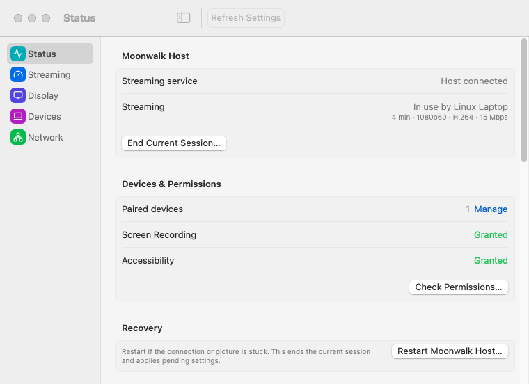

# Moonwalk Host

Moonwalk Host is a macOS streaming host developed for
[Moonwalk](https://github.com/joaodriessen/moonwalk) on Linux. Standard
Moonlight clients can also pair and stream the Mac's desktop.

The macOS app runs in the menu bar. It manages the streaming service,
pairing, permissions, and display settings from the logged-in user session.

## Installation

Moonwalk Host is in alpha. It requires Apple Silicon and macOS 14 or later.
Tester builds are distributed as a signed and notarized DMG. Install the
app in **Applications** and grant **Screen Recording** and **Accessibility**
during setup.

To pair on the local network, start pairing from the client. On the Mac,
open **Pair New Device…** in the menu bar app, select the pending device,
and enter the PIN shown by the client. [Install and pair](docs/INSTALL.md) ·
[Build from source](docs/BUILDING.md)

## Displays and sessions

By default, the host asks macOS to create a virtual display using the
client's requested resolution and refresh rate and tries to make it the
primary display. This supports headless operation after setup, while the Mac
is awake and logged in. You can also select an existing display for capture.
[Display settings](docs/guides/settings.md#display)

After the last viewer leaves, capture stops and the host releases the
virtual display. If the Desktop session is still available to resume, the
menu shows **Ready to Resume**. **Quit Moonwalk Host** stops the streaming
service.

## Client support

Moonlight-compatible clients use the standard protocol for video, stereo
audio, keyboard, and mouse input. Compatible Moonwalk builds also support
text and image clipboard sync, file transfer, remote cursor shapes, live
bitrate control, and 1× or 2× desktop scale requests for supported display
modes. [Compatibility](docs/compatibility.md)

Paired devices are managed under **Settings → Devices**. LAN video is
unencrypted by default. You can require encryption in Settings.
[Security](SECURITY.md)

## Documentation

[Settings](docs/guides/settings.md) ·
[Troubleshooting](docs/TROUBLESHOOTING.md) ·
[Architecture](docs/architecture.md) ·
[Contributing](CONTRIBUTING.md) · [Changelog](CHANGELOG.md)

Moonwalk Host builds on [Sunshine](https://github.com/LizardByte/Sunshine)
and [Lumen](https://github.com/trollzem/Lumen).
[GPL-3.0-only](LICENSE) · [Third-party code](docs/third-party.md)
