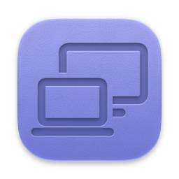
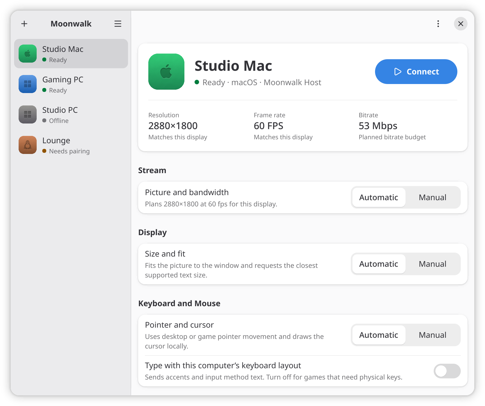

  

<h1 align="center">Moonwalk Host</h1>

Use your Mac from another device on your local network.

  <a href="docs/INSTALL.md">Install and pair</a> ·
  <a href="docs/TROUBLESHOOTING.md">Troubleshooting</a> ·
  <a href="https://github.com/joaodriessen/moonwalk-host/releases">Releases</a>

Moonwalk Host runs in your Mac’s menu bar. It sends your desktop and sound to [Moonwalk](https://github.com/joaodriessen/moonwalk) on Linux or to a [Moonlight](https://moonlight-stream.org/) client. Your keyboard and mouse work on the Mac while you’re connected. Quit Moonwalk Host and it stops accepting connections.

This is a **private alpha** for **Apple Silicon** Macs running **macOS 14 or later**. Invited testers install a signed and notarized DMG when one is available. See the [installation guide](docs/INSTALL.md) for the permissions macOS asks for and how to pair a device.

## Use the display in front of you

By default, the host asks macOS to create a virtual display for your client’s requested size and refresh rate. It can make that display primary while you’re connected, so you can use your desktop even with no monitor attached. Available modes and text sizes depend on macOS and the client. Your Mac needs to be awake and logged in. You can also share an existing display. [Display settings](docs/guides/settings.md#display)

  <picture>
    <source media="(prefers-color-scheme: dark)" srcset="docs/assets/moonwalk-view-dark.png">
    
  </picture>

Moonwalk’s host list on Linux, rendered with example devices and planned settings.

## Choose a client

| | Moonwalk | Moonlight |
| --- | --- | --- |
| Video, stereo audio, keyboard and mouse | Yes | Yes |
| Request a virtual display and reconnect to Desktop | Yes | Yes |
| Clipboard, regular-file transfer and remote cursor shapes | With compatible builds | |
| Request a supported macOS text scale and adjust bitrate during a stream | With compatible builds | |

The app starts with H.264 and SDR. You can enable HEVC in Settings. A controller can emulate keyboard and mouse input. See [compatibility and limits](docs/compatibility.md) for display, headless and client coverage.

## Keep access under your control

Pair only devices you trust. A paired device can control your Mac while the host is running. Review or remove it in **Settings → Devices**. Use a trusted LAN and leave port forwarding off. Video is unencrypted with the default LAN settings. [Security and reporting](SECURITY.md)

## Work on Moonwalk Host

Start with [Building](docs/BUILDING.md), [Contributing](CONTRIBUTING.md), or the [architecture notes](docs/architecture.md). [All documentation](docs/README.md)

Moonwalk Host builds on [Sunshine](https://github.com/LizardByte/Sunshine) and the macOS work in [Lumen](https://github.com/trollzem/Lumen). It uses the GameStream-compatible protocol supported by [Moonlight](https://moonlight-stream.org/). [GPL-3.0-only](LICENSE) · [Third-party notices](NOTICE)
