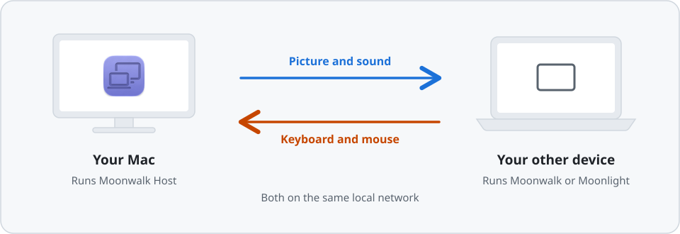

# How Moonwalk Host works

  <picture>
    <source media="(prefers-color-scheme: dark)" srcset="../assets/how-it-works-dark.svg">
    
  </picture>

## From connection to picture

1. When Moonwalk Host is open, it advertises the Mac on the local network. A client can also add it by address.
2. A paired client requests a video size and frame rate. The host prepares a virtual or physical display according to its settings and the modes macOS can provide.
3. ScreenCaptureKit captures the desktop. The encoder compresses each frame, normally in hardware. The network carries the picture and sound to the client, which decodes and displays them.
4. The host passes the client’s keyboard and mouse events to macOS through Accessibility.
5. When the last viewer leaves, capture stops and the host releases the virtual display. The Desktop entry can remain ready to resume, depending on your disconnect setting.

## Moonwalk features

Any compatible Moonlight client uses the same basic video, sound and input protocol. Both Moonwalk and Moonwalk Host must support a companion feature to use it.

| Feature | What it covers |
| --- | --- |
| Clipboard | Text and PNG images up to 4 MiB during a stream |
| Files | Regular files up to 8 GiB, within Downloads, Documents or Desktop, for the active client |
| Cursor shapes | The Mac’s pointer shape drawn on your own device |
| Text size | A request for one of the host’s supported 1× or 2× modes |
| Automatic bitrate | A supported client can update the encoder target during the stream |

## Network behavior

| Default port | Protocol | Purpose |
| --- | --- | --- |
| 47984 | TCP | Paired HTTPS |
| 47989 | TCP | Host information and pairing |
| 48010 | TCP | Stream negotiation |
| 47998 | UDP | Video |
| 47999 | UDP | Control |
| 48000 | UDP | Audio |
| 47990 | TCP | Optional web settings |

Moonwalk Host advertises the `_nvstream._tcp` service through mDNS. The optional web settings page is off by default. When used, it can request resources from GitHub, `app.lizardbyte.dev` and `images.igdb.com`. Router setup through UPnP is off by default. [Security](../../SECURITY.md) · [Architecture](../architecture.md)
